# Harpo user manual

Harpo is your team's password manager. It keeps shared passwords in **groups**
that only the right people can open, remembers every password an account has
ever had, generates 2FA codes for shared accounts, and gives you a **personal
vault** for the passwords that are yours alone.

This manual is about using Harpo in the browser. Setting a Harpo site up (Active
Directory, replication, backups) is covered in the [README](../README.md); if
you are the person running the server, read that too.

## Contents

1. [The ideas in one minute](#the-ideas-in-one-minute)
2. [Signing in and out](#signing-in-and-out)
3. [The vault page](#the-vault-page)
4. [Adding and editing a password](#adding-and-editing-a-password)
5. [Revealing, copying and 2FA codes](#revealing-copying-and-2fa-codes)
6. [Details and notes](#details-and-notes)
7. [Password history](#password-history)
8. [Searching](#searching)
9. [Deleting and restoring](#deleting-and-restoring)
10. [Importing and exporting](#importing-and-exporting)
11. [Your personal vault](#your-personal-vault)
12. [Groups and members](#groups-and-members)
13. [Vault health](#vault-health)
14. [The offline vault](#the-offline-vault)
15. [On a phone or tablet](#on-a-phone-or-tablet)
16. [Administration](#administration) (site administrators)
17. [Who can do what](#who-can-do-what)

## The ideas in one minute

- **Groups hold passwords.** A group has members, and only its members (plus the
  site administrators) can see what is in it. "Infrastructure", "Marketing" and
  "Finance" are typical groups.
- **Members have a role in each group.** *Viewers* can see and copy; *members*
  can also add and change passwords; *admins* additionally run the group and
  decide who is in it.
- **Site administrators** see every group and look after the Harpo site as a
  whole. They are chosen by your directory, not inside Harpo.
- **Your personal vault** is for passwords only you should see. Nobody else can
  open it, site administrators included.
- **Nothing is forgotten.** Every password an entry has ever had stays in its
  history, deleted passwords sit in a recycle bin until restored, and revealing,
  copying or deleting anything is written to an audit log the administrators
  can read.

## Signing in and out

Open Harpo in your browser and sign in with your normal **Active Directory
account**: the short username you use at work (not your e-mail address) and
your usual password. Harpo does not keep a password of its own for you; when
you change your Windows password, you use the new one here too.

A few things to know:

- After several wrong passwords in a row, sign-in for that account pauses for a
  while. Wait a few minutes and try again.
- Your session ends after a period of inactivity set by your administrator
  (eight hours by default). When it ends, or when your directory account is
  disabled, any Harpo page you still have open sends you back to the sign-in
  page by itself.
- **Sign out** is at the top right. It ends your session everywhere: another
  tab you left open is signed out too.

## The vault page

Vault is the first thing you see after signing in. The top panel lists your
vaults; the lower panel shows the passwords in the one you have selected.

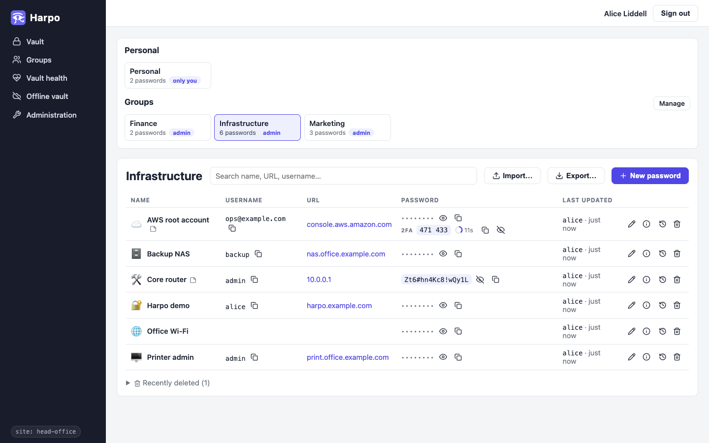

**Personal** is your personal vault, marked *only you*. **Groups** lists the
groups you belong to, each with its password count and a badge for your role:
*admin* if you administer it, *site admin* if you see it only because you are
a site administrator, no badge if you are an ordinary member. **Manage** takes
you to the Groups page.

Select a vault and its passwords appear as a table, one row per entry:

| Column | What it shows |
| --- | --- |
| **Name** | The entry's icon and name. A small note icon means the entry has notes. |
| **Username** | The account the password belongs to, with a copy button. |
| **URL** | Where the account is used. Web addresses are links that open in a new tab. |
| **Password** | Hidden by default. Reveal, hide and copy buttons, and a **2FA** chip when the entry has a 2FA secret. |
| **Last updated** | Who last changed the password and how long ago. Hover for the exact time. |
| Actions | Edit, details and notes, password history, delete. Viewers see only details and history. |

A vault with more than 50 passwords shows them 50 at a time. **First**,
**Previous**, **Next** and **Last** under the table move between pages, and the
count between them says which passwords you are looking at. The page is part
of the address, so reloading keeps it and the browser's Back button returns to
the page before. Searching always covers the whole vault and starts again at
the first match.

The toolbar above the table has the search box and, if you may add passwords
here, the **Import…** and **New password** buttons; group admins also see
**Export…** (see [Importing and exporting](#importing-and-exporting)). If you
are a viewer, the buttons are replaced by a *viewer* badge and the edit and
delete buttons are not shown.

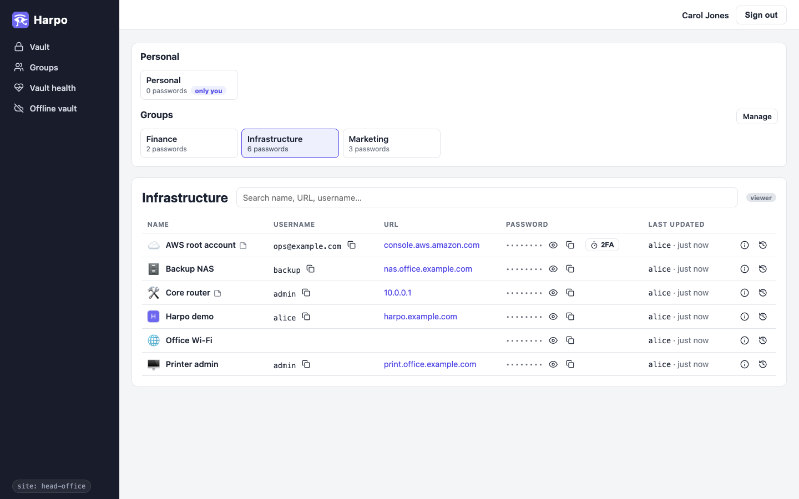

## Adding and editing a password

Click **New password** in a vault you can write to.

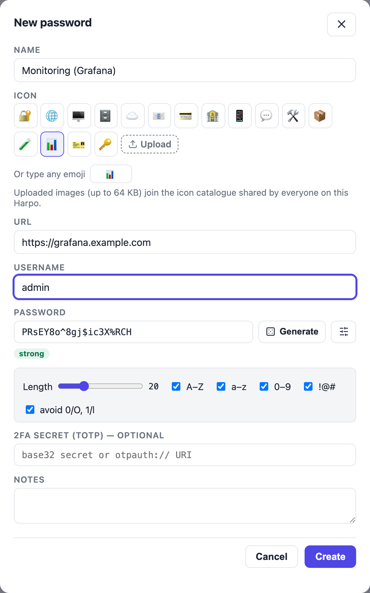

- **Name** is the only required field besides the password. Use the name
  people will search for ("Core router", not "cisco-01-mgmt").
- **Icon** picks the emoji or image shown in the list. Choose a preset, type
  any emoji, pick one of the images your organisation has uploaded, or upload
  a new image (up to 64 KB), which then becomes available to everyone. When
  the URL you type matches an uploaded image's host, that icon is chosen for
  you.
- **URL** and **Username** are optional but make the entry findable and let the
  details view link straight to the site.
- **Password**: type one, or click **Generate** for a random 20-character
  password. The sliders button opens the generator options: length from 8 to
  64, which character classes to use, and whether to avoid characters that
  look alike (0/O, 1/l). A badge under the field rates the password from
  *terrible* to *strong* as you type.
- **2FA secret** is optional. Paste the base32 secret or the whole
  `otpauth://` link from the service's "can't scan the QR code?" option, and
  the entry will show 2FA codes (see below).
- **Notes** are for anything that does not fit elsewhere: recovery codes,
  which port the console is on, who owns the contract. Notes are encrypted like
  passwords and are only shown on request, in the details view.

Click **Create**. The dialog checks what it can before saving and points at the
field that needs attention. **Escape** or **Cancel** closes it without saving.

**Editing** uses the same dialog, from the pencil button on the row. The
password field starts empty: leave it empty to keep the current password, or
enter a new one to change it (the old one goes into the history). If the
entry has a 2FA secret, leave the 2FA field empty to keep it, paste a new
secret to replace it, or tick **Remove 2FA**.

## Revealing, copying and 2FA codes

Passwords are shown as dots until you ask for them.

- The **eye** button reveals the password in place; the crossed eye hides it
  again.
- The **copy** button puts the password on your clipboard without showing it. A
  short message confirms the copy. The copy buttons next to usernames work the
  same way.
- Entries with a 2FA secret show a **2FA** chip. Click it and the current
  code appears with a countdown ring showing how long it stays valid,
  a copy button, and a hide button. The code refreshes itself at each rollover
  and disappears on its own after two minutes.

Each reveal and copy of a password or 2FA code is recorded in the audit log
with your name. That is not a reason to avoid them, it is the point: shared
passwords are shared, and the team can see who used what.

## Details and notes

The **i** button on a row opens a read-only view of the entry: the full URL as
a link, the username with a copy button, who last changed the password and
exactly when, whether 2FA is configured, and the notes with a **Copy notes**
button. The password itself is not shown here; use the row's reveal button, so
every reveal is still recorded.

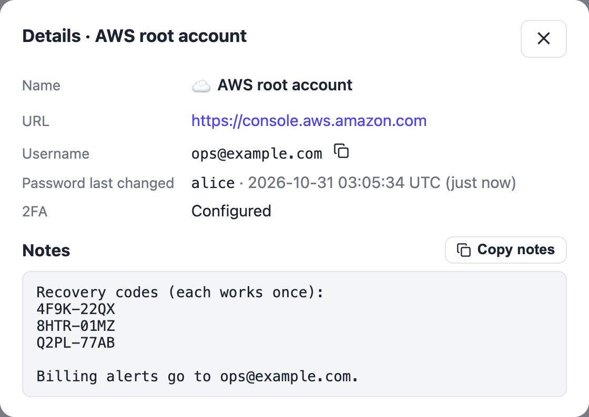

Everyone who can see the entry can open its details, viewers included. This is
where recovery codes belong: in the notes, visible when you need them, not in
a chat message.

## Password history

The **clock** button on a row shows every password the entry has ever had,
newest first, with who set it and when. Each old value can be revealed or
copied like a current one (and is recorded the same way). Nothing is ever
removed from the history.

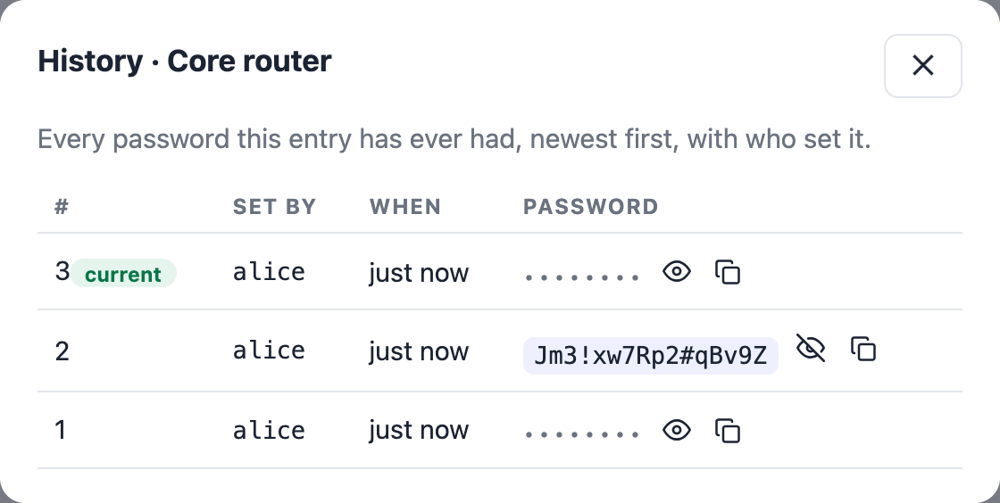

This is how you recover from a change that should not have happened, and how
you answer "what was the password before Tuesday?" without asking around.

## Searching

Type in the search box above the table and the list narrows to entries whose
name, URL or username contains what you typed. Once you have typed two or more
characters, Harpo also looks through your **other** vaults and lists any
matches under **Also in other vaults**, each with the vault it lives in.
Clicking the vault name opens that vault with the same search applied.

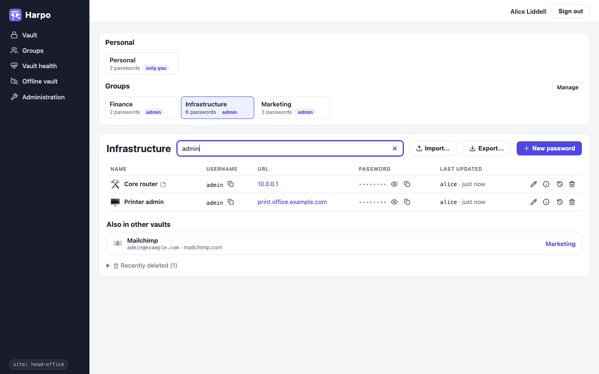

Search results from other vaults never show passwords or notes, only the
name, username and site, so you still go to the vault to reveal a password.

## Deleting and restoring

The **bin** button on a row deletes the entry after a confirmation. Deleting
hides the entry everywhere; it does not destroy it. Below the table,
**Recently deleted** lists what has been deleted from this vault, by whom and
when, with a **Restore** button that brings the entry back, history and all.
Nothing is purged automatically, and the recycle bin is shown only to people
who can edit the vault.

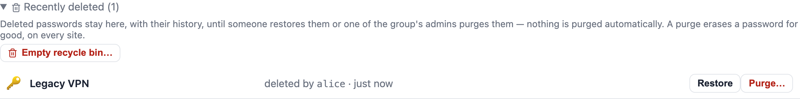

Deleting a whole group works the same way, from the group's page (see below);
a site administrator can restore it from the Administration page.

## Importing and exporting

### Bringing passwords in from another manager

If your team's passwords live in Bitwarden, 1Password, KeePass, LastPass or a
browser today, export them from there as a **CSV file**, open the Harpo vault
they belong in, and click **Import…**. Anyone who can add passwords to the
vault can import into it.

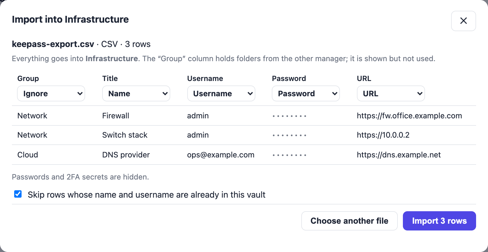

Choose the file and Harpo shows what it found before anything is created:

- **One drop-down per column** says what that column becomes: name,
  username, password, URL, notes, 2FA secret, or *Ignore*. Exports from the
  managers above are recognised by their column names, so usually there is
  nothing to change. A name and a password column are required.
- **The first few rows** are shown so you can check the columns line up.
  Passwords and 2FA secrets are shown as dots.
- **Folders are not used.** Other managers' folder or group columns are
  shown but ignored: everything goes into the vault you have open. Import
  each folder into its own group if you want them apart.
- **Skip rows whose name and username are already in this vault** is on by
  default, so importing the same file twice does not give you every entry
  twice. Untick it to create them anyway.

Click **Import** and a summary says how many entries were created, how many
were skipped because the vault already had them, and which rows could not be
imported and why: a row with no name or no password (a secure note, say), or
a 2FA secret that is not one. The row number is the line in the file, so you
can find it. Imported passwords are ordinary entries from then on, with you as
the person who set them.

The file you imported from holds those passwords in plain text. Delete it once
you are done, and empty your computer's recycle bin.

### Taking a copy out

Group admins and site administrators can download a whole group as a file
with **Export…**, and you can download your own personal vault the same way
(nobody else can, site administrators included). Members and viewers cannot; they reveal
passwords one at a time.

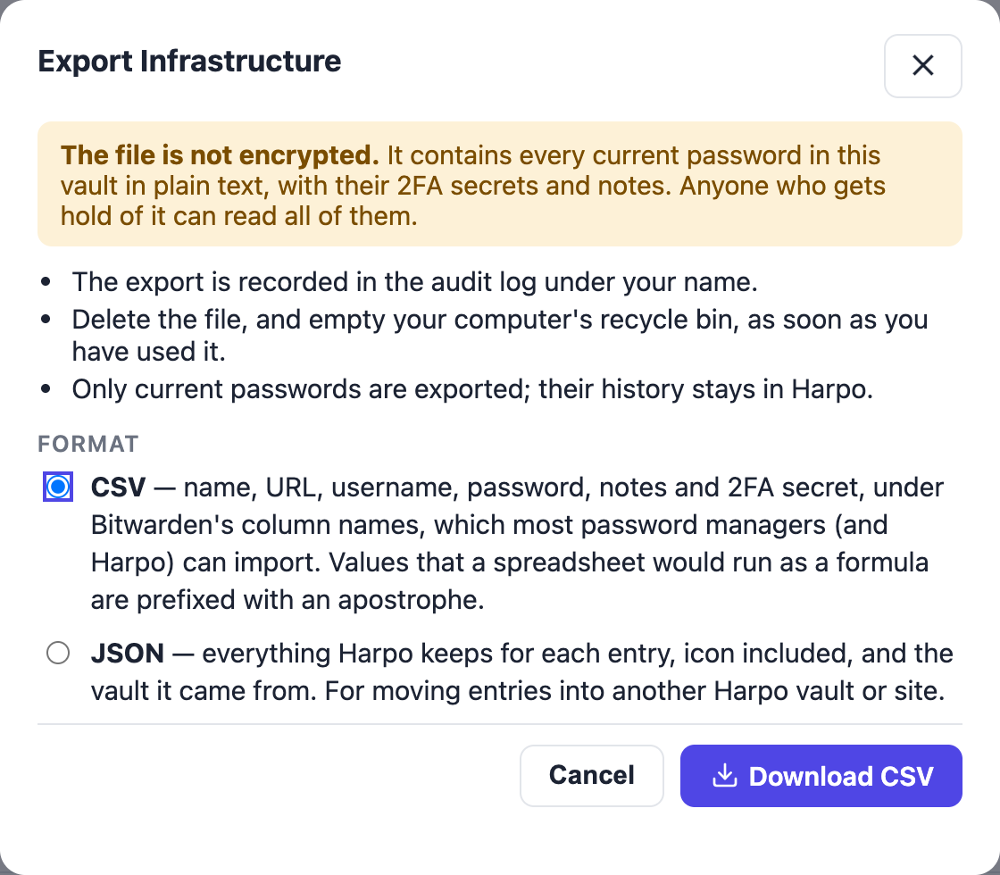

Choose a format:

- **CSV** is what other password managers import (it uses Bitwarden's column
  names). It holds each entry's name, URL, username, password, notes and 2FA
  secret. Values that a spreadsheet would treat as a formula, such as a
  password starting with `-` or `=`, are written with an apostrophe in front
  so opening the file in Excel cannot run anything. Harpo recognises its own
  file when you import it back and removes the apostrophe again, so nothing
  changes on a round trip; files from other managers are imported exactly as
  they are. Other managers may keep the apostrophe.
- **JSON** is Harpo's own format, with icons too. Use it to move entries into
  another Harpo vault or site.

Only the current passwords are exported, not their history. Take the dialog's
warning seriously: **the file is not encrypted**, and anyone who gets hold of
it can read every password in it. Every export is recorded in the audit log
under your name. Use the file for what you needed it for, then delete it.
Your administrator can turn exporting off for the whole site, in which case
the button is not there.

## Your personal vault

The first time you open the vault page, Harpo creates your **personal vault**
and lists it above your groups with an *only you* badge. It behaves like any
other vault: add passwords, keep 2FA secrets, see history, use the recycle
bin, include it in your offline copy.

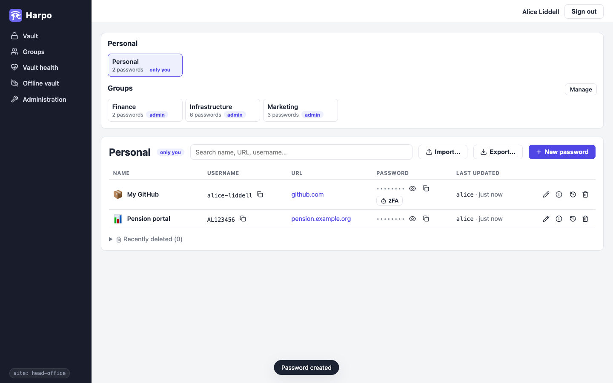

What makes it personal:

- **Only you can open it.** Not your colleagues, not the group admins, not the
  site administrators. It has no members to add and no settings to change.
- **The audit log keeps the names to you.** When you reveal or copy something
  here, the log records that you did, but describes the entry only as "an
  entry in a personal vault".
- **It follows you to every site.** If your organisation runs Harpo in more
  than one location, you have the same personal vault everywhere.

Personal does not mean work passwords should not go there. It is the right
place for the account only you use at work. Be aware, though, that **when
someone leaves, a site administrator can take their personal vault over** so
that company accounts kept in it are not lost. The vault then becomes an
ordinary group with that administrator in it, the takeover is written to the
audit log, and the former owner stays a member, so if this ever happened to you
while you still worked there, you would see it in your vault list. (The people
who run the server could in principle read any vault from the database; a
personal vault is private from colleagues and administrators in Harpo, not
from the server's operators.)

## Groups and members

**Groups** in the sidebar lists the groups you belong to, with member and
password counts and your role.

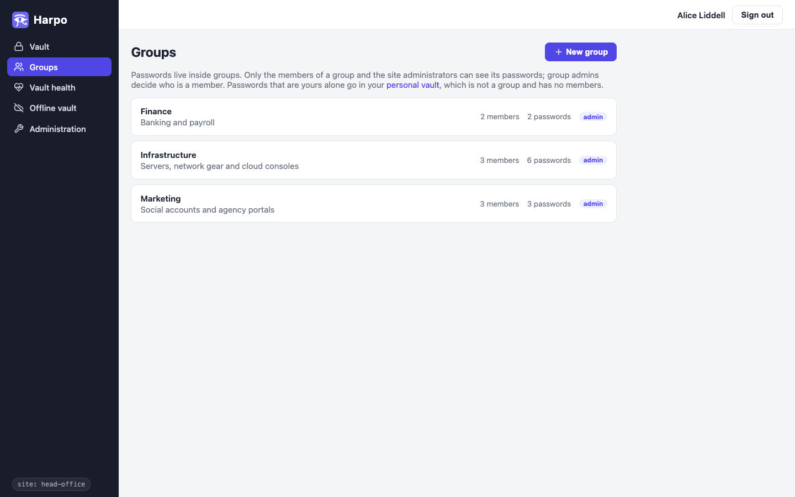

**New group** asks for a name and an optional description. You become the new
group's admin, and you are its only member until you add people. Anyone can
create a group.

Click a group to open its page. What you see depends on your role: a member or
viewer sees the member list; a group admin sees the settings, the member list
with controls, and the danger zone. **Open in vault** jumps to the group's
passwords.

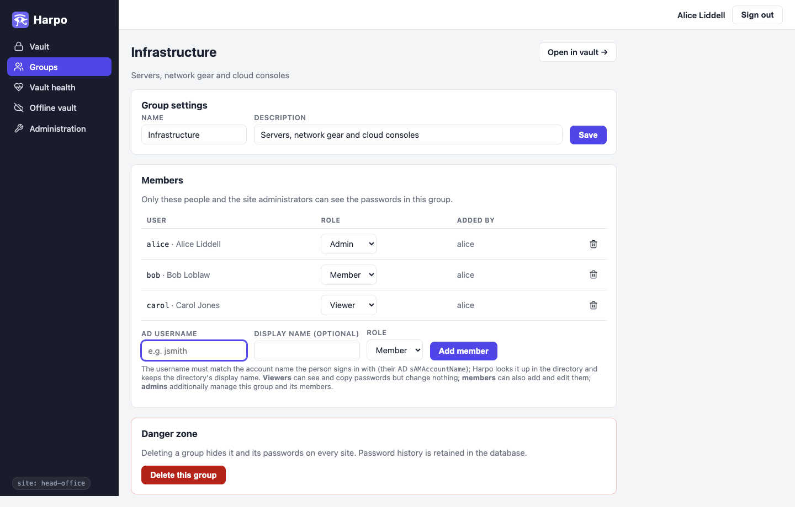

### Members and roles

The **Members** table lists everyone in the group, their role and who added
them. Group admins can change a member's role with the drop-down or remove a
member with the bin button.

| Role | Can |
| --- | --- |
| **Viewer** | See, reveal and copy passwords and 2FA codes, read details and notes, see history. Change nothing. |
| **Member** | Everything a viewer can, plus add, edit, delete and restore passwords. |
| **Admin** | Everything a member can, plus rename the group, manage members, and delete the group. |

To add someone, type their **AD username** (the account name they sign in
with). As you type, Harpo looks the name up in the directory and offers
matching accounts; pick one and the display name is filled in from the
directory. Choose a role and click **Add member**. Harpo refuses a name that
the directory does not know or that belongs to a disabled account, so a typo
cannot quietly give access to nobody or to the wrong person.

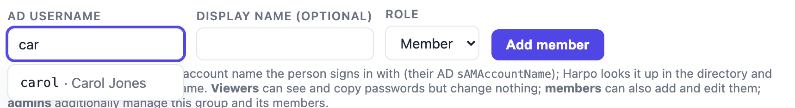

If the directory cannot be asked at that moment (your site may not have a
directory service account configured, or the directory may be down), the form
says so, the name is stored exactly as typed, and the member is shown with an
*unverified* badge until someone checks it. The person can still sign in and
use the group as long as the name matches their account.

A group must keep at least one admin. Should a group end up without one (this
can happen when two sites change roles while they are out of contact), the
members keep their access and a site administrator can appoint a new admin.

### Renaming and deleting a group

Group admins change the name and description under **Group settings** and
click **Save**. **Delete this group** in the danger zone hides the group and
all its passwords from everyone. Like a deleted password, a deleted group is
not destroyed: the Administration page lists deleted groups with a **Restore**
button.

## Vault health

**Vault health** in the sidebar grades the passwords you are responsible for:
group admins see the groups they administer, site administrators see
everything, and nobody sees anyone else's personal vault.

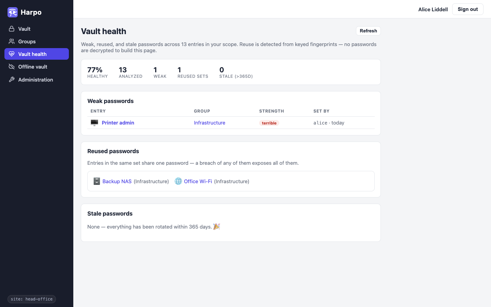

- **Weak** lists passwords that score *terrible* or *weak*: too short, too
  predictable, or on the list of passwords everybody tries first.
- **Reused** groups entries that share one password. A breach of any of them
  exposes all of them. Harpo finds these without decrypting anything, by
  comparing fingerprints. If a password is also used by an entry in a group
  outside your scope, you see "+1 outside your groups" rather than its name.
- **Stale** lists passwords unchanged for longer than your organisation's
  limit (a year by default).

Every entry name is a link that opens the vault with that entry filtered, so
fixing a finding is a click and an edit away. **Refresh** recalculates the
report.

## The offline vault

If your administrator has enabled it, **Offline vault** in the sidebar lets
you keep an encrypted, **read-only** copy of the passwords you can see on the
device you are using, so you can still get to them when the Harpo server is
unreachable (an outage, a train, the server room whose door code is in
Harpo).

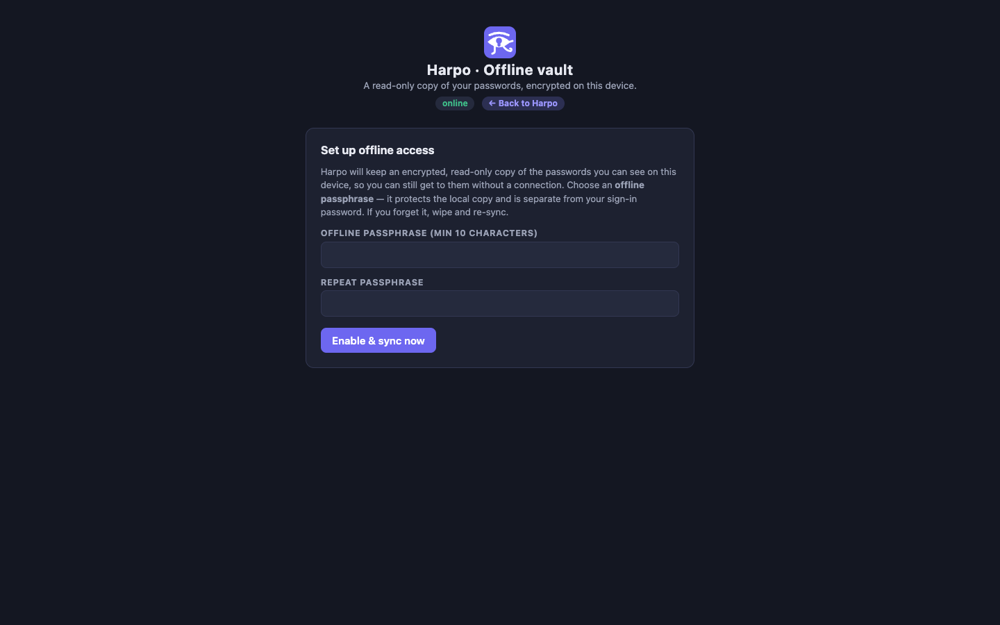

**Setting it up.** Choose an **offline passphrase** of at least ten characters.
It protects the copy on this device and is separate from your sign-in
password; Harpo cannot recover it for you, so if you forget it, wipe the copy
and set it up again. Click **Enable & sync now** and the device downloads your
entries, encrypts them with your passphrase, and shows them.

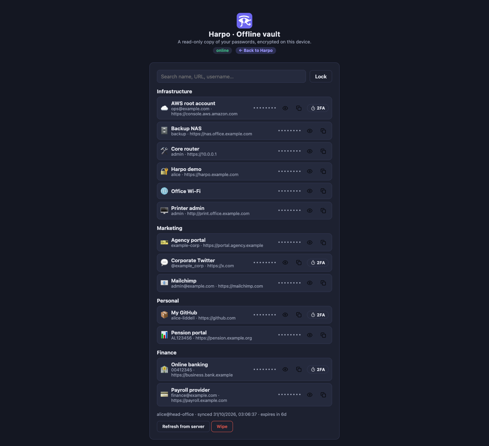

**Using it.** Open the same page (or the app, if you installed Harpo, see
below) and enter your passphrase. You get your entries grouped by vault, with
search, reveal and copy, and 2FA codes generated on the device. You cannot add
or change anything offline; changes are made online, in the normal vault.

The offline list also shows 50 passwords at a time, with the same buttons
under it; search covers everything, and locking starts again at the first page.

Good to know:

- The copy covers the groups you are an explicit member of and your personal
  vault. Site administrators do not get a copy of every group they can see.
- **Refresh from server** updates the copy whenever you are online. A copy
  that has not been refreshed for a while (seven days by default) stops
  unlocking until you sync again.
- The vault **locks itself** after ten minutes without activity; **Lock** does
  it at once.
- **Wipe** deletes the copy from the device. Do this on a shared or borrowed
  computer when you are done, and before handing a device in.
- The copy belongs to your account. If a colleague signs in to Harpo in the
  same browser, their refresh is refused rather than mixing their passwords
  into your copy; wipe it to set up one for them.
- If your administrator turns offline access off, the device deletes its copy
  the next time it talks to the server.
- Taking a copy is recorded in the audit log, like a reveal.

**Installing Harpo as an app.** Harpo is a web app you can install: look for
"Install app" in your browser's address bar or menu, or "Add to Home Screen"
on a phone. The installed app opens in its own window and, when the server is
unreachable, lands on the offline vault.

## On a phone or tablet

Every page works on a small screen. The entry table becomes a list of cards
with the same buttons, dialogs fill the screen, and the details view is the
easiest way to read notes on a phone.

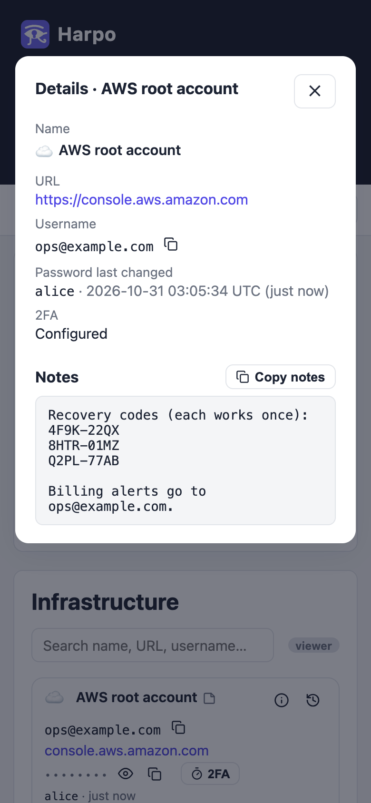

## Administration

Site administrators have one more page, **Administration**. The chips under
the title jump to its sections.

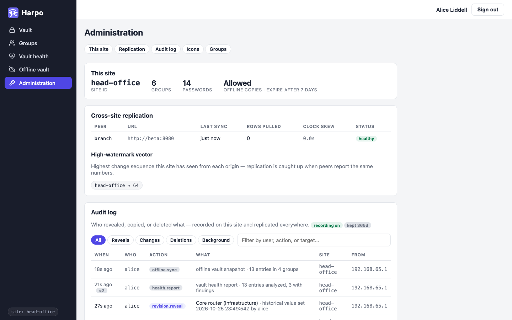

**This site** shows the site's name, how many groups and passwords it holds,
and whether offline copies are allowed and for how long. If the master key is
being rotated, a notice says so.

**Cross-site replication** appears when your organisation runs Harpo in more
than one location. It lists the other sites, when each was last reached, and
a *healthy*, *waiting* or *error* badge; hover an error for the reason. A
*drift* warning means the sites' clocks disagree by more than 30 seconds,
which matters because the newest change wins when two sites edit the same
thing.

### Audit log

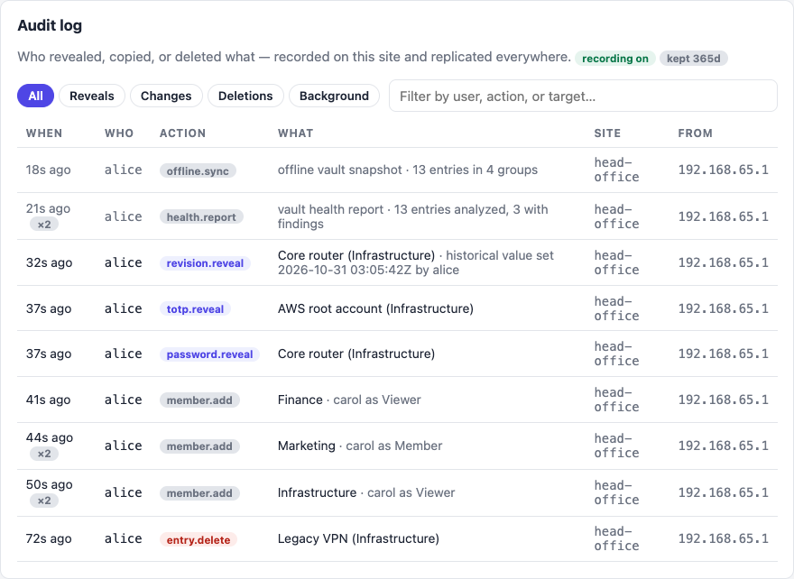

The audit log records who revealed, copied or deleted what, when, from which
site and address, with membership changes, 2FA events, offline syncs and
health-report views alongside. Events from every site are shown together,
newest first.

- The chips narrow the list to **Reveals** (passwords and 2FA codes shown or
  copied, vaults exported), **Changes** (membership, icons, takeovers,
  imports), **Deletions**, or
  **Background** (offline syncs and report views, which are shown dimmed in
  the full list).
- The filter box matches on the person, the action or the target.
- A run of the same person doing the same thing to the same object is folded
  into one row with a count (×2, ×3) so routine use does not bury the event
  you are looking for; hover the time to see the span.
- **Load older events** continues the list.

Password *changes* are not audit events; each entry's history already records
them permanently. Events in personal vaults name the person and the action but
describe the entry only as "an entry in a personal vault".

### Icon catalogue

Images that people have uploaded for entry icons. You can rename an icon, set
the **matched URLs** (hostnames whose entries pick the icon up automatically),
or delete it; entries using a deleted icon fall back to the default glyph. You
can also add icons here directly, and import any images the server operator
has placed in the site's icon folder with **Import now**.

### Groups

- **Groups without an admin** lists groups nobody can manage any more, with a
  link to appoint one.
- **Deleted groups** lists groups that have been deleted, with **Restore**.
  Restoring a group brings back its passwords, except those that had been
  deleted individually before.
- **All groups** lists every group on the site with its creator and counts.
  Personal vaults are not listed; they are not groups.

### Personal vaults

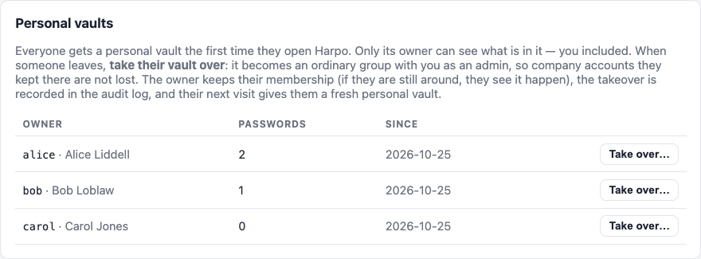

Everyone who has opened Harpo has a personal vault, listed here by owner with
the number of passwords in it. You cannot see inside them. What you can do,
when someone leaves and company accounts may be in their vault, is **take it
over**.

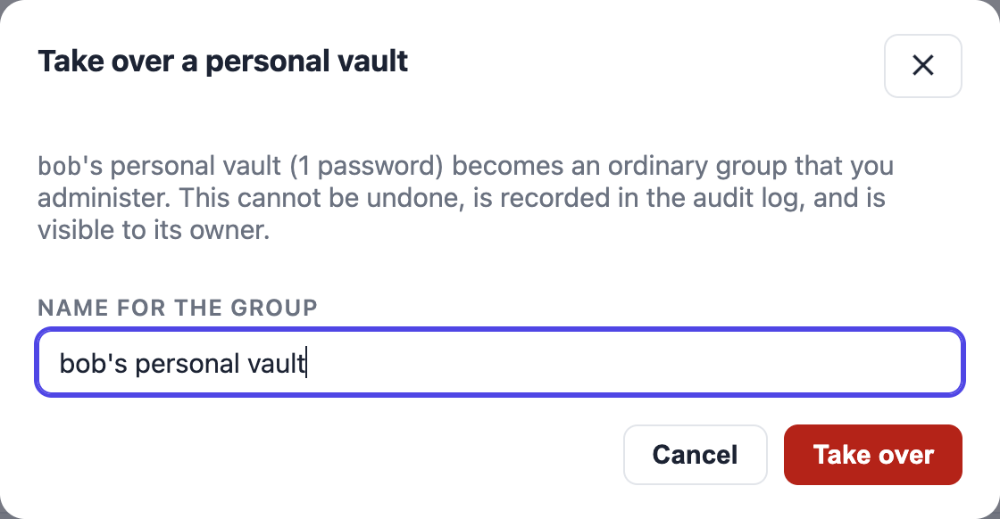

Give the resulting group a name and confirm. The vault becomes an ordinary
group with you as an admin and the former owner as a member, the takeover is
written to the audit log, and the person gets a fresh, empty personal vault
on their next visit. This cannot be undone, and if the person is still around
they will see it happen. Use it for departures, not curiosity.

## Who can do what

| | Viewer | Member | Group admin | Site admin |
| --- | --- | --- | --- | --- |
| See, reveal and copy passwords and 2FA codes | ✓ | ✓ | ✓ | ✓ (all groups) |
| Read details and notes, see history | ✓ | ✓ | ✓ | ✓ |
| Add, edit, delete and restore passwords | | ✓ | ✓ | ✓ |
| Import passwords from a file | | ✓ | ✓ | ✓ |
| Export the whole vault to a file | | | ✓ | ✓ (not personal vaults) |
| Rename the group, manage members, delete the group | | | ✓ | ✓ |
| Create a new group | ✓ | ✓ | ✓ | ✓ |
| Vault health report | | | own groups | whole vault |
| Offline copy | own groups | own groups | own groups | own groups |
| Open someone else's personal vault | | | | |
| Audit log, icon catalogue, restore groups, take over a personal vault | | | | ✓ |

Roles are per group: the same person can be an admin of one group and a viewer
of another. In your personal vault you can do everything in the first five rows,
importing and exporting included. Site administrators are defined by directory group membership,
which your IT department manages.

---

*The screenshots in this manual come from a throwaway demonstration site with
made-up accounts and passwords. They are regenerated with
`tests/e2e/manual-screenshots.js`.*
